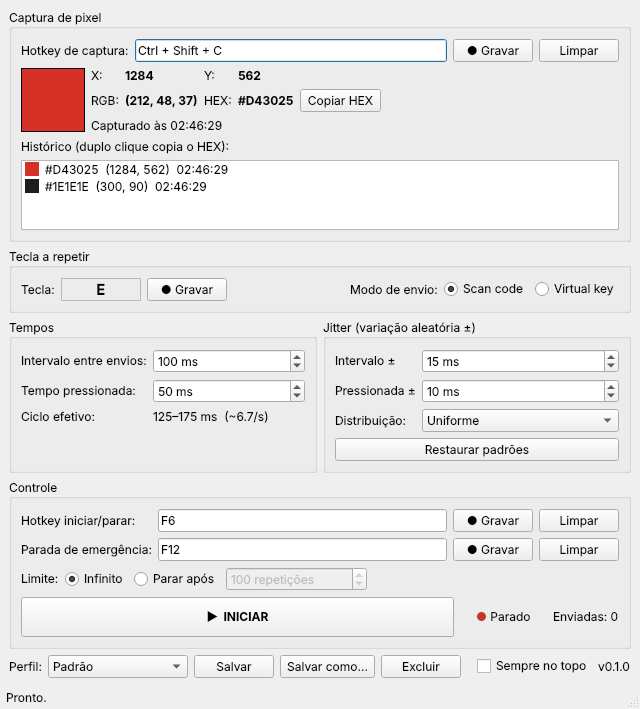

# AutoKey Pixel

Repetidor de tecla para Windows com **jitter configurável** e **captura de pixel do cursor** (cor, X e Y) por hotkey global.



## Download

O executável é gerado automaticamente pelo GitHub Actions:

- **Versão estável:** página [Releases](../../releases) → `AutoKeyPixel.exe`
- **Último build de `main`:** aba [Actions](../../actions/workflows/build.yml) → execução mais recente → artefato `AutoKeyPixel-windows`

Não precisa instalar nada: é só executar o `.exe`.

## Funcionalidades

| Área | O que faz |
|---|---|
| **Captura de pixel** | Hotkey global configurável (padrão `Ctrl+Shift+C`) lê a posição do cursor e a cor do pixel abaixo dele. Mostra X, Y, RGB, HEX, amostra da cor e histórico das últimas 10 capturas (duplo clique copia o HEX). |
| **Tecla a repetir** | Clique em **● Gravar** e pressione a tecla. Envio por **scan code** (padrão, compatível com jogos DirectInput) ou **virtual key**. |
| **Tempos** | Intervalo entre envios (padrão **100 ms**) e tempo com a tecla pressionada (padrão **50 ms**). Mostra o ciclo efetivo resultante. |
| **Jitter** | Variação aleatória ± para o intervalo (padrão **15 ms**) e para o pressionamento (padrão **10 ms**), limitada a 50% do valor base. Distribuição **uniforme** ou **gaussiana limitada**. |
| **Controle** | Hotkey iniciar/parar (padrão `F6`), parada de emergência (padrão `F12`), limite de repetições opcional. |
| **Perfis** | Salvar / salvar como / excluir, gravados em `%APPDATA%\AutoKeyPixel\profiles\*.json`. O perfil atual é salvo ao fechar. |

## Observações importantes

- **Escala de tela (DPI):** o app se declara *per-monitor DPI aware*, então X/Y são coordenadas físicas da tela e a cor é lida corretamente em 125%, 150% etc.
- **Janelas como administrador:** o Windows bloqueia teclas simuladas enviadas para programas elevados. Se o alvo roda como admin, use o botão **Reiniciar como admin**.
- **Antivírus:** executáveis PyInstaller que usam hook de teclado às vezes são marcados como suspeitos (falso positivo). O código-fonte e o build estão neste repositório.
- **Jogos online:** muitos proíbem automação de entrada nos termos de uso, com ou sem jitter. Verifique antes de usar.

## Rodar a partir do código

Requer Python 3.11+ (recomendado 3.12) no Windows.

```bash
python -m venv .venv
.venv\Scripts\activate
pip install -r requirements-dev.txt
python run.py
```

Testes:

```bash
pytest -q
```

Gerar o `.exe` localmente (o mesmo comando do pipeline):

```bash
pyinstaller --noconfirm --clean --onefile --windowed --name AutoKeyPixel --collect-submodules keyboard run.py
```

## Pipeline (GitHub Actions)

`.github/workflows/build.yml` roda em `windows-latest` a cada push, pull request ou execução manual:

1. instala as dependências;
2. roda os testes unitários e um *smoke test* da interface;
3. gera `AutoKeyPixel.exe` com PyInstaller;
4. publica o `.exe` como artefato do build;
5. em tags `v*` (ex.: `v0.1.0`), cria uma **Release** com o `.exe` anexado.

Para publicar uma nova versão: atualize `__version__` em `autokey_pixel/__init__.py` e depois:

```bash
git tag v0.2.0
```

```bash
git push origin v0.2.0
```

## Arquitetura

```
run.py                       # launcher (usado pelo PyInstaller)
autokey_pixel/
├── main.py                  # define DPI awareness ANTES do Qt e abre a janela
├── core/
│   ├── win32.py             # ctypes: SendInput, GetCursorPos, GetPixel, DPI, elevação
│   ├── pixel.py             # captura (x, y, r, g, b)
│   ├── timing.py            # jitter + espera interrompível de alta resolução
│   ├── repeater.py          # thread: pressiona → segura → solta → espera
│   └── hotkeys.py           # hotkeys globais (biblioteca keyboard)
├── config/profile.py        # perfil (dataclass) + persistência JSON
└── ui/
    ├── main_window.py       # janela PySide6
    └── widgets.py           # campo de hotkey e botão de captura de tecla
tests/                       # pytest (lógica independente de Windows)
```

Pontos de projeto:

- A repetição roda numa thread separada; os eventos voltam para a interface via *signals* do Qt.
- A tecla é **sempre liberada** ao parar, mesmo se a parada ocorrer no meio do pressionamento.
- A espera usa `time.sleep` (timer de alta resolução no Windows desde o Python 3.11) em fatias de 10 ms contra um prazo em `perf_counter`. Isso dá precisão de milissegundos e parada quase instantânea.

## Licença

MIT
